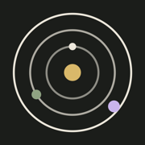
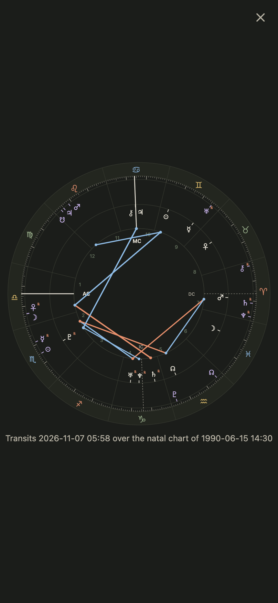

#  Orrery

Your transits, forecasts and birth chart, one tap each. The charts are
computed on your own computer by [astro-mcp](https://github.com/akuttruff/astro-mcp)
and drawn at once. A local model then writes the reading over them,
streamed in and kept. No accounts, no cloud.

## What it looks like

<table>
  <tr>
    <td width="50%"></td>
    <td width="50%"></td>
  </tr>
  <tr>
    <td><b>Home.</b> Six shortcuts, each a cast, and the recent castings by kind.</td>
    <td><b>Today.</b> The transits over the birth chart as a wheel, then every contact in a table with its weight.</td>
  </tr>
  <tr>
    <td></td>
    <td></td>
  </tr>
  <tr>
    <td><b>The reading.</b> Written by the model, with what it cost, then your questions and its answers underneath.</td>
    <td><b>A week.</b> The contacts exact this week, then the slow planets in orb all week, with the frame the reading was written in.</td>
  </tr>
  <tr>
    <td></td>
    <td></td>
  </tr>
  <tr>
    <td><b>The birth chart.</b> The chart itself, and a reading of it.</td>
    <td><b>The wheel full size.</b> A tap on any wheel opens it over the reading to pinch and zoom; Done or Back returns.</td>
  </tr>
  <tr>
    <td></td>
    <td></td>
  </tr>
  <tr>
    <td><b>A spread.</b> Three cards, or the Celtic Cross, dealt for a question in your words and read position by position.</td>
    <td><b>The daily card.</b> One card for the day; the tile opens it again rather than dealing twice. Under any chart reading, <i>Pull a card</i> deals one and reads it against the reading.</td>
  </tr>
</table>


**On a desktop.** The castings in a sidebar beside the one open.

The screenshots use a fictional person and demo readings. To regenerate them:

```bash
npm run seed:demo && npm run dev   # one terminal
npm run screenshots                # another; needs Google Chrome
```

## Before you start

### How it fits together

```
your phone or desktop browser
        │  http, over your own network
        ▼
Orrery ── one Node process on one computer ── .data/orrery.sqlite, memory.sqlite
        │
        ├──▶ astro-mcp, started by Orrery          (the charts, in under a second)
        ├──▶ tarot-mcp, started by Orrery          (the cards, and their pictures)
        └──▶ a model server on the same computer   (the readings and the answers)
```

Orrery is one Node process that serves the app to any browser on your
network and keeps the castings and memories in SQLite on that computer. For
a cast, Orrery runs the ephemeris itself and draws the chart at once. For
the reading, it sends the chart to a model server beside it and streams
the text back, so a phone that locks mid-reading loses nothing. Your phone
talks only to Orrery.

### What you need

| For | You need |
|---|---|
| Casting a chart and seeing the wheel and tables | Node 24 or newer, and [astro-mcp](https://github.com/akuttruff/astro-mcp) installed on the same computer (below) |
| A reading written over it | A model server with a chat model (below) |
| Follow-up questions that look things up | The model server able to call astro-mcp as an MCP server, with its authentication on |
| Opening it on your phone | The phone on the same Wi-Fi, or [Tailscale](https://tailscale.com) on both devices (see *Run*) |

Node 24 is the floor because castings are stored with `node:sqlite`, which
arrived in that version. Check with `node --version`.

### The ephemeris

Orrery starts astro-mcp for every cast and talks to it directly, so the
wheel is on screen in under a second. Install it following its README
(Python 3.10 or newer and `uv`), then either:

- register it with your model server under the name `astrology-v2`. Orrery
  reads the command from LM Studio's `~/.lmstudio/mcp.json`, and the same
  entry lets the model call it for follow-up questions; or
- check it out at `~/Code/astro-mcp` with its `.venv` created, which Orrery
  falls back to.

### A model server

Orrery sends the chart and its brief to a model server's `/api/v1/chat`
endpoint, the API that [LM Studio](https://lmstudio.ai) 0.4 introduced,
because it carries MCP tool calls, reasoning levels and streamed replies in
one request. LM Studio is the server these steps use. Any other server that
implements that same API works the same way; one that offers only the
OpenAI chat API does not, yet. Nothing leaves your network.

1. Install the server and download a chat model. In LM Studio that is the
   Discover tab. Orrery is written and tested against `qwen/qwen3.8-27b`.
   Any chat model works; a smaller one writes faster and shallower. Give
   it a context length of at least 16K.
2. Start the server. In LM Studio that is the **Developer** tab. It listens
   on `http://127.0.0.1:1234`, Orrery's default; Settings takes another
   address.
3. If the server asks for a token (in LM Studio, **Require Authentication**
   under **Manage Tokens**), paste it into Orrery's Settings. It is kept on
   the server and never sent to the browser. LM Studio requires
   authentication for the follow-up questions' tool calls.
4. For follow-up questions to call the ephemeris, let the model server call
   it: in LM Studio, **Allow calling servers from mcp.json** in the
   Developer settings.
5. Settings offers the server's reasoning levels. `low` is the default and
   the sweet spot; `off` is faster and flatter.

If [LM Chat](https://github.com/akuttruff/lm-chat) is set up on the same
computer, the first run copies its model server address, token and model,
so there is nothing to type twice.

## Casting

A shortcut (Today, This week, This month, Year ahead, Moon, Birth chart)
maps to one or two astro-mcp tools. The server keeps one astro-mcp process
running and calls them directly, so the wheel and tables are on screen in
under a second and the model never picks a wrong tool.

Every tap casts anew. The earlier castings of that kind stay, so a day can
hold several readings of the same kind, and Recast adds one more. A casting
is `#/c/<id>` in the address, so Back and a reload both land where expected.

**A week is Sunday to Saturday.** Cast on a Thursday, it covers Thursday to
Saturday.

**A week and a month list every transit.** The forecast tool picks a few
headlines. Both castings also run the ephemeris scan over the same days and
keep every contact in orb, in two groups: the period's events, exact inside
it, and its backdrop, in orb without perfecting. The forecast still casts if
the scan fails.

**Every transit has a weight.** The table's last column is the forecasts'
own ranking: the transiting planet's slowness (Mercury 0.5 up to Pluto 5),
doubled on the Sun, Moon, Ascendant, MC or chart ruler, times the aspect.
Pluto on the Sun is 10 and fills the bar.

## The reading

The tool's own result goes to LM Studio with a brief that asks for a full
paragraph per contact, in plain words and tied to the person's life:
several hundred words for a day, over a thousand for a year.

The model writes on the server, so a phone that locks mid-reading loses
nothing. Back during a reading leaves it writing, and the home screen lists
what is in progress. Stop keeps what was written. A reading takes as long
as it takes (ten to fifteen minutes is normal for a 27B model thinking
first); only a model that goes quiet for five minutes is given up on.

Before casting, a popup takes the choices a reading is made with:

- **What it is for**, in your words: "deciding about the job this week".
- **The kind of reading**: balanced, companion, coach, strategist, gentle or
  plain. Each is a sentence or two in the brief where the tone lives.
- **Memory**, on or off, with a list to leave particular memories out.

All of it stays on the casting, so Write again and the questions under it
keep the same frame, and the brief is shown under the reading. "Read it
again as" casts the same kind anew in another tone, beside the first.

## Under the reading

**The wheel's popups read too.** Hovering a planet or an aspect line, or a
press and hold on a phone, shows its position and aspects. On a Today wheel
each aspect also carries a sentence on what that transit tends to bring up,
written by the model in one short call beside the reading.

**Ask about it.** A box under every reading takes follow-up questions. Each
answer is written on the server like the reading and kept with the casting.
An answer may call the astrology tools through LM Studio for anything the
casting's data does not cover: another day, a return, a horary question.

**The trail and the cost.** Everything the model did on the way to its text
is kept with it: each stretch of thinking, as a "Thought for 4.2s" row that
opens, and each tool call, as a card. Under the text: when it finished, how
long it took, the model, and LM Studio's token counts.

## Memory

Orrery keeps its own memories, in `memory.sqlite` beside the castings
database. A casting read with memory on gets what
is known about the person in its prompt, framed as information to use only
where the chart touches it, and the page says how many memories the reading
drew on.

With memory on, each question asked is also sent to the model for what it
reveals about the person. What is kept is shown under the answer with a
Forget button. The Memories screen lists, corrects, adds and deletes.

Memory is off by default. Settings sets the default and each casting has
its own switch.

## Run

```bash
npm install
npm run dev          # http://localhost:8400, scratch database in .data-dev/
npm run check        # typecheck, lint, tests
npm run deploy       # build and restart the launchd instance on :8410
npm run seed:demo    # fill the dev database with demo castings
npm run screenshots  # regenerate docs/screenshots/ from the dev server
```

Then open Settings and enter whose chart it is: name, birth date and time,
and birthplace.

The persistent instance is `com.amie.orrery` (launchd), served by Tailscale
at `https://<your-machine>.<your-tailnet>.ts.net:8445`:

```bash
/Applications/Tailscale.app/Contents/MacOS/Tailscale serve --bg --https=8445 http://127.0.0.1:8410
```

Its data lives in `.data/orrery.sqlite`. The page is served from the
browser's cache on every launch, so it opens at once on the phone and says
so if the server cannot be reached.

## Settings

Whose chart (name, birth date and time, birthplace) and who writes (LM
Studio address, API token, model, reasoning level), plus whether readings
draw on memory by default.

## Layout

```
server/   api.ts (routes), store.ts (SQLite), astro.ts (astro-mcp over stdio),
          cast.ts (which tools a shortcut runs), prompt.ts (the briefs),
          readings.ts (writing on the server), memory.ts, remember.ts
src/      App.tsx, components/, lib/ (chartWheel, forecastTable, weight, route)
public/   sw.js, the app shell cache
scripts/  deploy.sh, fixtures.ts, seed-demo.ts, screenshots.mjs
docs/     screenshots/ for this README
```
