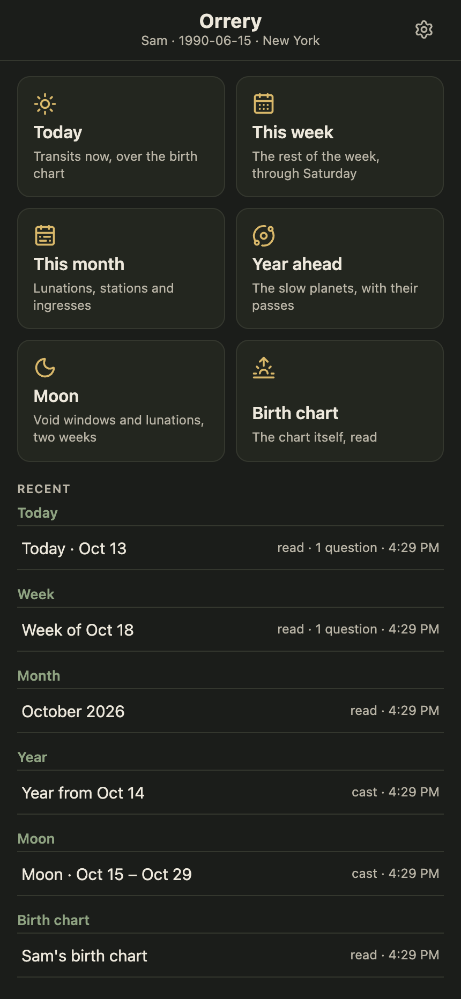
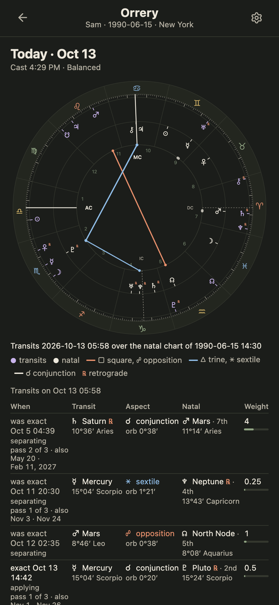
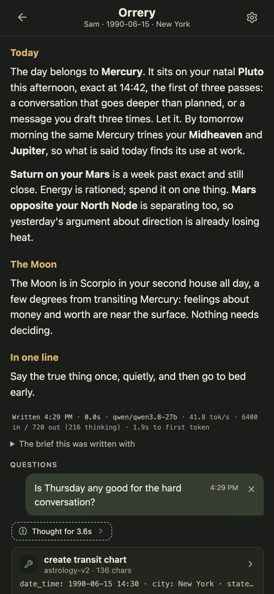
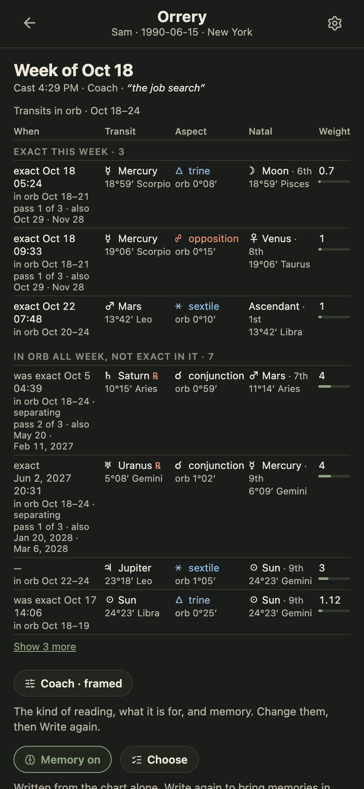
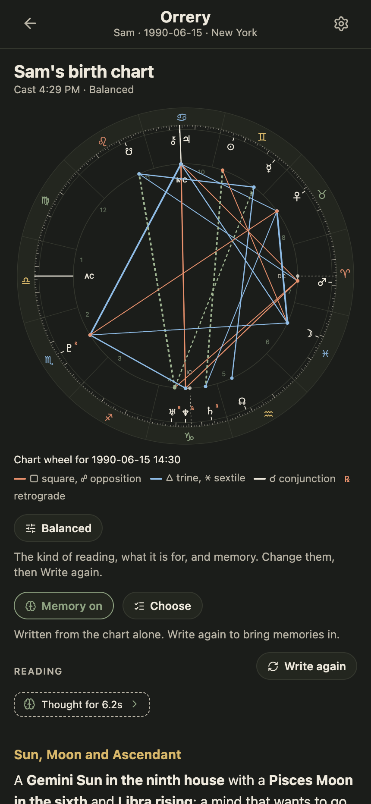
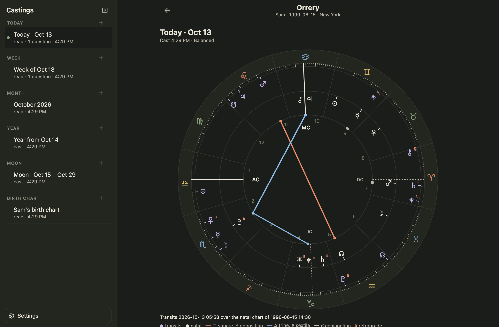

# Orrery

Your transits, forecasts and birth chart, one tap each. The charts are
computed on the Mac by [astro-mcp](../astro-mcp) and drawn at once. A local
model in LM Studio then writes the reading over them, streamed in and kept.

Standalone from LM Chat: nothing here touches the chat app or its data,
though it borrows the chat app's LM Studio settings on first run and the
same chart-drawing code, copied rather than shared.

## What it looks like

<table>
  <tr>
    <td width="33%"></td>
    <td width="33%"></td>
    <td width="33%"></td>
  </tr>
  <tr>
    <td><b>Home.</b> Six shortcuts, each a cast, and the recent castings by kind.</td>
    <td><b>Today.</b> The transits over the birth chart as a wheel, then every contact in a table with its weight.</td>
    <td><b>The reading.</b> Written by the model, with what it cost, then your questions and its answers underneath.</td>
  </tr>
  <tr>
    <td></td>
    <td></td>
    <td></td>
  </tr>
  <tr>
    <td><b>A week.</b> The contacts exact this week, then the slow planets in orb all week, with the frame the reading was written in.</td>
    <td><b>The birth chart.</b> The chart itself, and a reading of it.</td>
    <td></td>
  </tr>
</table>

<p></p>

The screenshots use a fictional person and demo readings. To regenerate them:

```bash
npm run seed:demo && npm run dev   # one terminal
npm run screenshots                # another; needs Google Chrome
```

## Casting

A shortcut (Today, This week, This month, Year ahead, Moon, Birth chart)
maps to one or two astro-mcp tools. The server keeps one astro-mcp process
running and calls them directly, so the wheel and tables are on screen in
under a second and the model never picks a wrong tool.

Every tap casts anew. The earlier castings of that kind stay, so a day can
hold several readings of the same kind, and Recast adds one more. A casting
is `#/c/<id>` in the address, so Back and a reload both land where expected.

**A week is Sunday to Saturday.** Cast on a Thursday, it covers Thursday to
Saturday.

**A week and a month list every transit.** The forecast tool picks a few
headlines. Both castings also run the ephemeris scan over the same days and
keep every contact in orb, in two groups: the period's events, exact inside
it, and its backdrop, in orb without perfecting. The forecast still casts if
the scan fails.

**Every transit has a weight.** The table's last column is the forecasts'
own ranking: the transiting planet's slowness (Mercury 0.5 up to Pluto 5),
doubled on the Sun, Moon, Ascendant, MC or chart ruler, times the aspect.
Pluto on the Sun is 10 and fills the bar.

## The reading

The tool's own result goes to LM Studio with a brief that asks for a full
paragraph per contact, in plain words and tied to the person's life:
several hundred words for a day, over a thousand for a year.

The model writes on the server, so a phone that locks mid-reading loses
nothing. Back during a reading leaves it writing, and the home screen lists
what is in progress. Stop keeps what was written. A model that never
finishes is given up on after ten minutes.

Before casting, a popup takes the choices a reading is made with:

- **What it is for**, in your words: "deciding about the job this week".
- **The kind of reading**: balanced, companion, coach, strategist, gentle or
  plain. Each is a sentence or two in the brief where the tone lives.
- **Memory**, on or off, with a list to leave particular memories out.

All of it stays on the casting, so Write again and the questions under it
keep the same frame, and the brief is shown under the reading. "Read it
again as" casts the same kind anew in another tone, beside the first.

## Under the reading

**The wheel's popups read too.** Hovering a planet or an aspect line, or a
press and hold on a phone, shows its position and aspects. On a Today wheel
each aspect also carries a sentence on what that transit tends to bring up,
written by the model in one short call beside the reading.

**Ask about it.** A box under every reading takes follow-up questions. Each
answer is written on the server like the reading and kept with the casting.
An answer may call the astrology tools through LM Studio for anything the
casting's data does not cover: another day, a return, a horary question.

**The trail and the cost.** Everything the model did on the way to its text
is kept with it: each stretch of thinking, as a "Thought for 4.2s" row that
opens, and each tool call, as a card. Under the text: when it finished, how
long it took, the model, and LM Studio's token counts.

## Memory

Orrery keeps its own memories, in `memory.sqlite` beside the castings
database, separate from lm-chat's. A casting read with memory on gets what
is known about the person in its prompt, framed as information to use only
where the chart touches it, and the page says how many memories the reading
drew on.

With memory on, each question asked is also sent to the model for what it
reveals about the person. What is kept is shown under the answer with a
Forget button. The Memories screen lists, corrects, adds and deletes.

Memory is off by default. Settings sets the default and each casting has
its own switch.

## Run

```bash
npm install
npm run dev          # http://localhost:8400, scratch database in .data-dev/
npm run check        # typecheck, lint, tests
npm run deploy       # build and restart the launchd instance on :8410
npm run seed:demo    # fill the dev database with demo castings
npm run screenshots  # regenerate docs/screenshots/ from the dev server
```

The persistent instance is `com.amie.orrery` (launchd), served by Tailscale
at `https://<your-machine>.<your-tailnet>.ts.net:8445`. Its data lives in
`.data/orrery.sqlite`.

## Local models

Everything the model does happens on this machine, through
[LM Studio](https://lmstudio.ai). No cloud service, no account.

1. **LM Studio 0.4 or newer**, since Orrery talks to its `/api/v1/chat`
   endpoint. Start the server in the Developer tab. It listens on
   `http://127.0.0.1:1234`, Orrery's default.
2. **A model.** Orrery is written and tested against `qwen/qwen3.8-27b`.
   Any chat model LM Studio can load works; a smaller one writes faster and
   shallower. Give it a context length of at least 16K.
3. **Reasoning.** Settings offers LM Studio's reasoning levels. `low` is the
   default and the sweet spot. `off` is faster and flatter.
4. **A token**, only if LM Studio's Require Authentication is on. It is kept
   on the server and never sent to the browser. Authentication is required
   for the follow-up questions' tool calls.
5. **astro-mcp**, the ephemeris. Orrery starts it itself for every cast,
   using the command written for it in `~/.lmstudio/mcp.json` under the
   name `astrology-v2`, falling back to `~/Code/astro-mcp/start-server.sh`.
   For follow-up questions to call it too, enable *Allow calling servers
   from mcp.json* in LM Studio's Developer settings.

The first run copies the LM Studio address, token and model from LM Chat's
database when it is on this machine, so there is nothing to type twice.

## Settings

Whose chart (name, birth date and time, birthplace) and who writes (LM
Studio address, API token, model, reasoning level), plus whether readings
draw on memory by default.

## Layout

```
server/   api.ts (routes), store.ts (SQLite), astro.ts (astro-mcp over stdio),
          cast.ts (which tools a shortcut runs), prompt.ts (the briefs),
          readings.ts (writing on the server), memory.ts, remember.ts
src/      App.tsx, components/, lib/ (chartWheel, forecastTable, weight, route)
scripts/  deploy.sh, fixtures.ts, seed-demo.ts, screenshots.mjs
docs/     screenshots/ for this README
```
